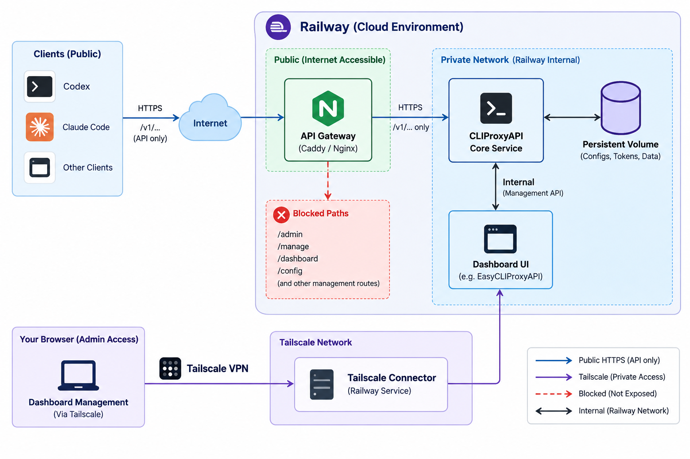

# CLIProxyAPI on Railway

Deploy your own [CLIProxyAPI](https://github.com/router-for-me/CLIProxyAPI) with
an authenticated public inference gateway and private management over Tailscale.
This repository contains deployment configuration, operational scripts, and
local security checks. Bring your own Railway project, tailnet, and provider
accounts; it does not include a hosted endpoint or credentials.



Conceptual overview; the service table below specifies this repository's exact
configuration.

## What gets deployed

| Service | Purpose | Exposure / persistence |
| --- | --- | --- |
| `gateway` | Caddy 2.11.4; enforces a separate client API key | Public HTTPS to port 8080; health port 8081 stays private |
| `core` | CLIProxyAPI 7.2.152 and dashboard 1.22.14 | Private port 8317; `/data` volume, 1 GiB |
| `admin` | Tailscale Forwarder; private HTTPS management | Tailnet port 8317; `/data` identity volume, 512 MiB |

The gateway forwards only the inference methods and paths in
[`gateway/Caddyfile`](gateway/Caddyfile). Its client key never grants management
access. Core and admin must have no public domains or TCP proxies.

[`.railway/railway.ts`](.railway/railway.ts) defines the infrastructure. All
services use one replica in Singapore; change the region consistently for
services and volumes before first deployment if needed. Persistent volumes
prevent horizontal replication, and core deployments can briefly interrupt
inference. Images are digest-pinned; the dashboard download is checksum-pinned.

## Quickstart

Requires a Railway account/workspace, authenticated Railway CLI (tested with
5.43.1), Node >=22, npm, and Python >=3.9. Commands below use
[UV](https://docs.astral.sh/uv/) to run Python; the scripts need no Python packages.
Install Caddy 2.11.4 separately to run the local gateway checks. A Tailscale
account and connected client are required for management and provider enrollment.

Clone your fork, enter its directory, then run:

```sh
npm ci --ignore-scripts
railway login
railway init --name cliproxyapi --workspace YOUR_WORKSPACE_ID --json
railway status
railway config plan
railway config apply
uv run --no-project python scripts/set_secrets.py
uv run --no-project python scripts/check_gateway.py --caddy /absolute/path/to/caddy
railway up --service core --detach
railway up --service gateway --detach
railway domain --service gateway --port 8080 --json
```

Review the infrastructure plan before applying. `--detach` starts deployment;
it does not establish health. Inspect the latest deployments and wait for
success before checking your generated domain:

```sh
railway deployment list --service core --limit 1 --json
railway deployment list --service gateway --limit 1 --json
uv run --no-project python scripts/check_public.py https://YOUR_GATEWAY_DOMAIN
railway config plan --detailed-exit-code
```

Generated domains are not managed by this IaC configuration. Attach the gateway
domain to **8080**, never 8081, and do not attach domains to core or admin.
A successful model-list check proves authentication, not usable provider accounts.

Next, follow [private management setup](docs/tailscale.md), enroll your provider
accounts, and verify real inference as described below. See
[deployment and recovery](docs/deployment.md) for existing projects and backups.

## Keys and deployment targeting

`set_secrets.py` recovers existing Railway keys when local files are absent,
or generates independent random keys for a new deployment. It stores them in
ignored `.secrets/` files with mode 600 and uploads via stdin. Keep an encrypted
recovery copy: Git does not back up `.secrets/`.

| Key | Used by | Share with |
| --- | --- | --- |
| `PROXY_API_KEY` | Clients → gateway | Your inference clients |
| `UPSTREAM_API_KEY` | Gateway → core | Nobody; internal credential |
| `MANAGEMENT_PASSWORD` | Private management API/dashboard | Administrators only |

Local credentials are bound to project/environment IDs in
`.secrets/railway-target.json`. Credential-writing scripts refuse a different
linked target. Use a separate checkout for each deployment. These helpers use
`railway login` and the local `railway link` context; project-token and target
environment-variable overrides are intentionally rejected. Review `railway status`
before operational commands. For existing, unbound secret files, see the
[one-time migration](docs/deployment.md#existing-deployments).

Keys must contain at least 32 ASCII letters, digits, underscores or hyphens.
Use `Authorization: Bearer KEY` or Anthropic's `X-Api-Key` header. Query-string
keys are rejected. The gateway does not enable browser CORS.

To rotate the public key, edit `.secrets/PROXY_API_KEY`, run `set_secrets.py`,
redeploy gateway, and update clients. Public-key rotation does not change
provider subscriptions.

For `UPSTREAM_API_KEY`, first add the new key alongside the old one through the
private dashboard's API Keys settings. Then edit the local secret file, run
`set_secrets.py`, and redeploy core and gateway. Verify inference before removing
the old key in the dashboard. Changing only the Railway variable breaks access
because the persistent core configuration retains its API keys.

To rotate management access, edit `.secrets/MANAGEMENT_PASSWORD`, run
`set_secrets.py`, and redeploy core. Keep the dashboard's separate `secret-key`
empty; a configured value remains another accepted management credential.

## Provider accounts

Use the private dashboard to authenticate your accounts, or import existing
CLIProxyAPI auth files over authenticated Railway SSH:

```sh
ssh-keygen -t ed25519 -f ~/.ssh/cliproxyapi_railway -C cliproxyapi-deployment
railway ssh keys add --key cliproxyapi_railway --name cliproxyapi-deployment
uv run --no-project python scripts/import_auth.py
```

Do not overwrite an existing SSH key; reuse it or choose another filename and
pass `--identity` to the import script. The tested Railway CLI discovers
registered keys in the standard SSH directory. Registration grants access as
its Railway user, so protect the private key accordingly.

The importer defaults to `~/.cli-proxy-api` and providers `claude`, `codex`,
`xai`. Use `--source` and `--providers` to select a different source or subset.
It skips existing destination files to preserve refreshed credentials. Auth
files contain refresh tokens: keep `/data/auths` private, avoid concurrent
refreshes of independent copies, and reauthenticate when tokens are rejected.

OAuth callback routes remain private. Use the dashboard's remote callback/paste
flow when a provider redirects to localhost on your device. Do not expose
callback ports publicly. Provider access and available models depend on your
own accounts and usage limits.

## Verify an endpoint / configure Claude Code

Copy `scripts/check_endpoint.py` to a client machine (Python >=3.9, no packages):

```sh
python3 check_endpoint.py --base-url https://YOUR_GATEWAY_DOMAIN --model YOUR_MODEL_ID
```

Both endpoint and model are required, supplied as arguments or through
`ANTHROPIC_BASE_URL` and `ANTHROPIC_MODEL`. The URL must be an HTTPS origin with
no `/v1`, path, query, or credentials. There is no hosted-endpoint default.

The script reads `PROXY_API_KEY`, `ANTHROPIC_AUTH_TOKEN`, or `ANTHROPIC_API_KEY`
in that order, otherwise prompts without echo. Use `--key-file /path/to/key`
to override environment credentials. Never pass the key itself as an argument.
It checks TLS, anonymous rejection, both authentication headers, model listing,
token counting, a completion, and an SSE stream ending in `message_stop`.
Inference consumes account usage; exit 0 means all checks passed.

For Claude Code, set `ANTHROPIC_BASE_URL` to your HTTPS origin **without `/v1`**
and `ANTHROPIC_AUTH_TOKEN` to your public proxy key. Clear a conflicting
`ANTHROPIC_API_KEY`, select an available model, and inspect `/status` for the
effective endpoint and credential source. Settings-file environment values can
override shell exports. See the
[Claude Code gateway guide](https://code.claude.com/docs/en/llm-gateway-connect).
OpenAI-compatible clients use `https://YOUR_GATEWAY_DOMAIN/v1` instead.

## Local checks and contributions

Run from the repository root:

```sh
uv run --no-project python -m unittest discover -s scripts -p 'test_*.py'
uv run --no-project python scripts/check_deployment_scripts.py
uv run --no-project python scripts/check_gateway.py --caddy /absolute/path/to/caddy
sh -n core/start.sh gateway/start.sh
```

The regression checks use fake credentials and mocked Railway/network calls.
The gateway check starts real Caddy against a loopback mock backend; it does
not use provider accounts. GitHub Actions runs these checks on pushes and pull
requests without deployment credentials. Live public/private/inference checks
are separate and must be run against your own deployment.

Keep changes small, include a regression check for changed security behavior,
and use Conventional Commits. Update the docs alongside changed commands.
For image upgrades, review upstream release notes and routes, update digests
and checksums (including the CI Caddy download), run checks, preview IaC, deploy,
and verify public/private access plus real inference.

## Limitations

- Shared-key access has no per-user accounting, quotas, or rate limiter.
- Only the explicitly listed OpenAI/Anthropic text routes and Codex voice routes
  (`POST /v1/live`, `GET /v1/live/:call_id`, `GET /v1/realtime`) are exposed.
  Voice uses the same client-key authentication; other realtime, Gemini-native,
  media, and arbitrary `/v1/*` routes are denied. Media relay remains disabled.
- Request bodies are limited to 32 MiB. Allowed routes support streaming and
  Caddy WebSocket forwarding; the local check does not prove provider streaming.
- Browser CORS requires an explicit origin policy. Railway's browser challenge
  can interfere with API clients and is not configured here.
- Core configuration is seeded once. IaC does not restore dashboard edits or
  provider tokens; back up the volumes and test restoration.

## License and upstream projects

This repository's original deployment code and documentation are
[MIT licensed](LICENSE). It is an independent deployment recipe. Upstream
components retain their own licenses and notices:

- [CLIProxyAPI — MIT](https://github.com/router-for-me/CLIProxyAPI/blob/main/LICENSE)
- [Management Center — MIT](https://github.com/router-for-me/Cli-Proxy-API-Management-Center/blob/main/LICENSE)
- [Caddy — Apache-2.0](https://github.com/caddyserver/caddy/blob/v2.11.4/LICENSE)
- [Tailscale Forwarder — MIT](https://github.com/brody192/tailscale-forwarder/blob/main/LICENSE)
- [Railway TypeScript SDK](https://github.com/railwayapp/railway-ts-sdk) — MIT

The Dockerfiles fetch upstream images and dashboard assets at build time; this
license does not replace their notices or those of bundled dependencies.
